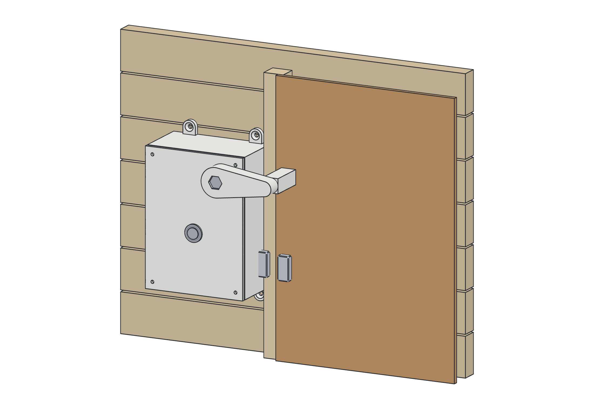
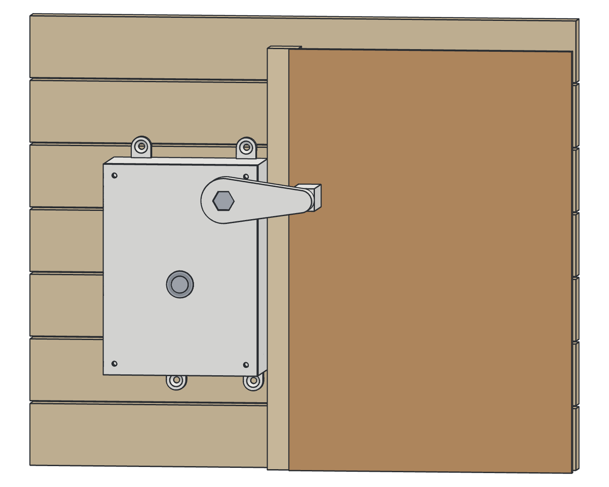
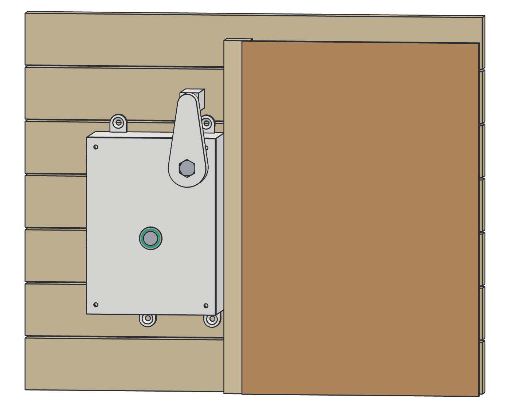

# Porte magique

Verrou connecté, sur batterie, pour la petite porte percée dans la clôture entre deux jardins voisins.
Chaque famille a sa porte, de son côté : le passage n'est ouvert que si les deux sont déverrouillées.



| Fermé | Ouvert |
|---|---|
|  |  |
| Le taquet passe devant le bord de la porte : on ne peut pas la pousser depuis l'autre côté. Voyant éteint. | Le taquet s'est levé d'un quart de tour : la porte est libre. Voyant vert quand les deux portes sont ouvertes. |

## Principe

- **Sur chaque porte** : un boîtier imprimé vissé sur la clôture, à côté du bord de la porte. Son taquet, entraîné par un servo, pivote devant le bord de la porte pour la bloquer. Dedans : une carte FireBeetle 2 ESP32-C6 en veille profonde, un module MOSFET qui coupe le servo au repos, un contact de porte, un bouton lumineux pour les enfants et une batterie LiPo rechargeable par USB-C.
- **Dans chaque maison** : une passerelle (une seconde carte FireBeetle) sur prise USB, reliée à la porte en ESP-NOW et au wifi de la maison.
- **L'appli** (`app/`) : une appli web pour téléphone, installable comme une appli, pour les deux familles. Chacune ouvre ou ferme sa porte (tout de suite, pour un moment, ou selon des horaires), voit celle des voisins, et reçoit une notification quand un enfant sonne.
- **Reste à écrire** : le programme des cartes (porte et passerelle). Leur dialogue avec l'appli est fixé dans `docs/api-passerelle.md`.

## Contenu

| Dossier | Contenu |
|---|---|
| `app/` | L'appli (Next.js, Supabase), la base de données (`app/liquibase/`) et le simulateur de passerelle |
| `docs/api-passerelle.md` | Dialogue entre la passerelle et l'appli |
| `docs/materiel.pdf` | Liste d'achat (source : `docs/materiel.html`) |
| `docs/notice.pdf` | Notice de montage, étape par étape (source : `docs/notice.html`, dessins dans `docs/notice/img/`) |
| `impression/` | Fichiers STL à imprimer, déjà orientés pour l'impression |
| `cad/` | Sources des pièces (JSCAD, en JavaScript) et des dessins de la notice |

## L'appli

Même base que Fridge : Next.js 16, Supabase (comptes, base, temps réel), connexion par email ou par empreinte (passkeys), notifications Web Push, design « Givre » façon iOS. Trois onglets :

- **Passage** : l'état des deux portes, ouvrir ou fermer la sienne (tout de suite ou pour 30 min, 1 h, 2 h), les demandes des enfants et le journal ;
- **Horaires** : les créneaux d'ouverture de sa porte, et ceux des voisins en lecture ;
- **Réglages** : la famille et les invitations, les voisins, les notifications, l'empreinte, la passerelle et le réglage du taquet.

Chaque famille ne commande que sa porte, ce que vérifie la base elle-même (RLS). On entre dans une famille par un lien d'invitation ; le premier lien « voisins » crée la seconde famille et sa porte.

### Mise en route

```bash
cd app
cp .env.local.example .env.local   # puis le remplir
npm install
npm run db:migrate                 # crée les tables (Liquibase : il faut Java)
npm run dev                        # http://localhost:3000
```

Dans le projet Supabase :

1. **Authentication → URL Configuration** : l'adresse de l'appli comme Site URL, et `http://localhost:3000/**` en Redirect URL pour le développement.
2. **Authentication → Passkeys** : activer, avec comme Relying Party ID le domaine définitif de l'appli. Ne plus le changer ensuite : les empreintes enregistrées ne marcheraient plus.

Sur Vercel : un projet sur ce dépôt avec `app` comme **Root Directory**, et les variables de `.env.local` (sauf `SUPABASE_DB_PASSWORD` et `SUPABASE_POOLER_HOST`).

### Essayer sans matériel

Dans l'appli : Réglages → Votre porte → **Associer une passerelle**, puis copier l'identifiant et la clé.

```bash
cd app
npm run simulateur -- <PORTE_ID> <PORTE_CLE>
```

Le simulateur joue la passerelle : le taquet obéit aux ordres de l'appli, et au clavier [b] fait sonner un enfant, [p] ouvre ou ferme la porte, [l] signale une batterie faible.

## Modifier les pièces

Toutes les cotes sont dans `cad/parametres.js` (par exemple la liste des longueurs de doigt du taquet).

```bash
cd cad
npm install
npm run stl       # régénère impression/*.stl
npm run rendus    # régénère les dessins de la notice (Chrome est nécessaire)
```

## Régénérer les PDF

```bash
CHROME="/c/Program Files/Google/Chrome/Application/chrome.exe"
"$CHROME" --headless --no-pdf-header-footer --print-to-pdf="D:/GIT/porte-magique/docs/materiel.pdf" "file:///D:/GIT/porte-magique/docs/materiel.html"
"$CHROME" --headless --no-pdf-header-footer --print-to-pdf="D:/GIT/porte-magique/docs/notice.pdf" "file:///D:/GIT/porte-magique/docs/notice.html"
```
